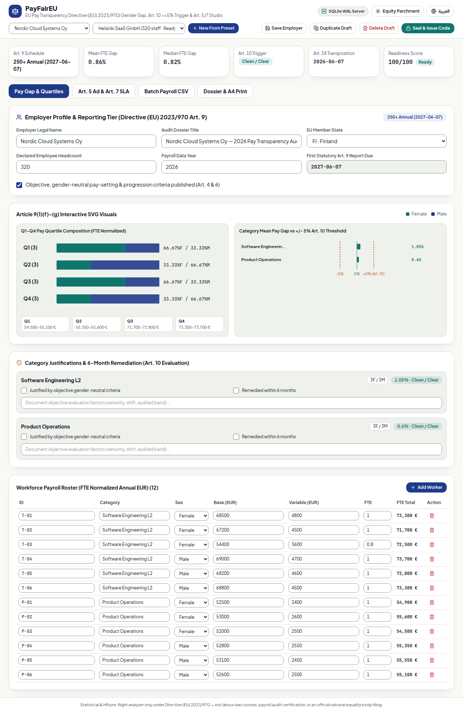
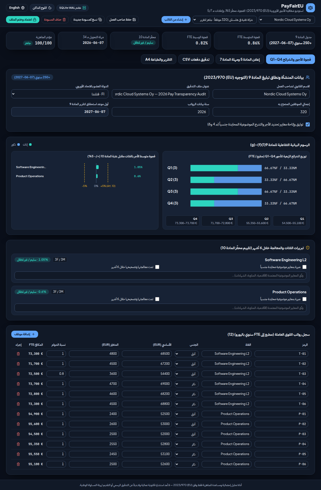
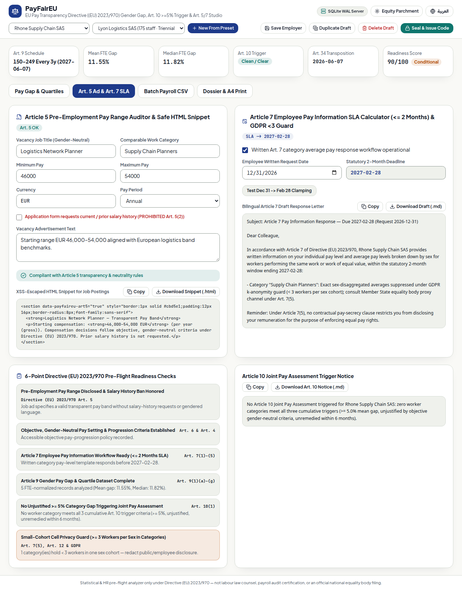
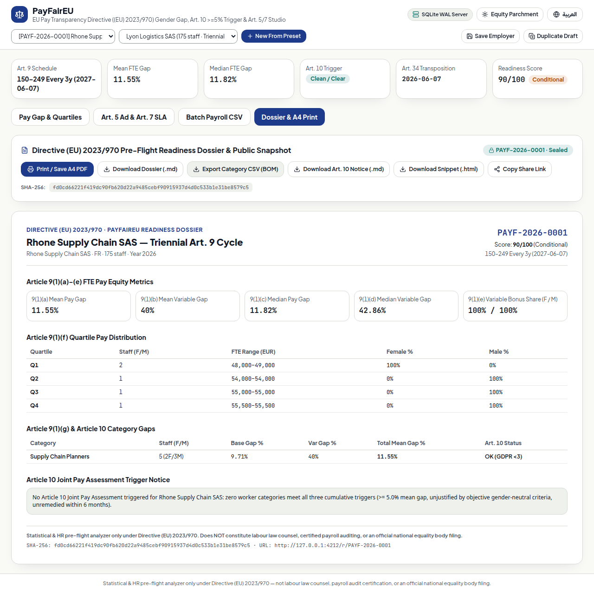
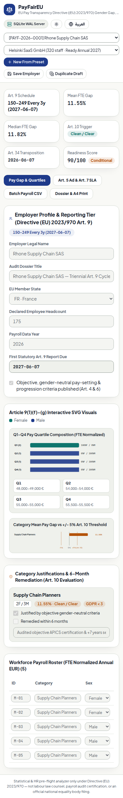
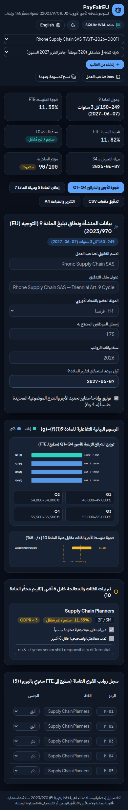

# PayFairEU | مطابقة شفافية الأجور الأوروبية `(EU) 2023/970`

[](https://github.com/manea/payfaireu/actions/workflows/ci.yml)
[](LICENSE)

Local-first, bilingual (**EN LTR / AR RTL**) pay-transparency studio for **Directive (EU) 2023/970** ahead of the **`2026-06-07`** national transposition deadline (`Art. 34`). Runs 100% inside the browser with zero external telemetry (`window.localStorage`) or self-hosted via **Node 22 + built-in `node:sqlite` WAL**.

> **Mandatory Legal Disclaimer:** `PayFairEU` is a statistical and HR readiness analyzer only under **Directive (EU) 2023/970**. It does **NOT** constitute labour law counsel, payroll audit certification, or an official national equality body filing. Zero worker payroll PII leaves your browser in static `$0` mode.

---

## Key Capabilities

1. **Article 9 FTE-Normalized Gender Pay Gap Engine (`9(1)(a)–(g)`)**:
   - Classifies statutory reporting obligations by headcount (`>=250` annual due `2027-06-07`, `150–249` triennial due `2027-06-07`, `100–149` triennial due `2031-06-07`, `<100` voluntary EU / subject to national transposition).
   - Normalizes part-time compensation (`basePay / fteRatio`, `variablePay / fteRatio`) to `1.0 FTE` and computes all 7 statutory metrics: mean/median total gaps, mean/median variable gaps, variable bonus receipt shares (`F / M`), `Q1–Q4` quartiles, and base + variable category breakdowns.
2. **Article 10 Cumulative `>= 5%` Joint Pay Assessment Trigger**:
   - Evaluates all 3 cumulative criteria per category (`|gap| >= 5.0%` AND `!justifiedByObjectiveCriteria` AND `!remediedWithin6Months`), with interactive category justification logs and bilingual Joint Assessment trigger notices.
3. **Article 5 Job-Ad Auditor & XSS-Safe HTML Generator**:
   - Checks disclosed pay ranges (`min > 0`, `max >= min`), enforces the **salary-history ban** (`Art. 5(2)`), flags vague/gendered language, and emits `escapeHtml()`-hardened HTML snippets ready for ATS / career pages.
4. **Article 7 Two-Month SLA Calculator & GDPR `< 3` Cell Privacy Guard**:
   - Calculates exact calendar end-of-month clamped response deadlines (`2026-12-31 -> 2027-02-28`) and suppresses sex-disaggregated averages when any sex cohort holds `< 3` workers (`GDPR` / `Art. 7(5)`).
5. **Batch Payroll CSV Auditor, UTF-8 BOM Formula-Safe Exports & Sealed Dossiers**:
   - Parses payroll CSV batches offline, exports formula-safe (`=`, `+`, `-`, `@` escaped, negative gap numbers preserved unquoted raw) `UTF-8 BOM CSV` files, seals audit dossiers (`PAYF-YYYY-0001`) with canonical `SHA-256` digests, and renders printable A4 executive reports.

## UI Previews

### Workspace — English LTR (`Equity Parchment`)


### Dual-Script Workspace — Arabic RTL (`Boardroom Slate`)


### Article 5 Job Ad Auditor & Article 7 SLA Workspace


### Sealed PayFairEU Dossier (`PAYF-YYYY-0001`, A4 Print & SHA-256)


### Mobile English LTR View (`390x844`)


### Mobile Arabic RTL View (`Boardroom Slate`, `390x844`)


---

## Quick Start (`$0`)

```bash
npm ci
npm run typecheck
npm test
npm run build
npm run start
```

Runs identically as pure static HTML/JS via `window.localStorage` (**Cloudflare Workers Static Assets**, see `wrangler.jsonc`) or self-hosted on **Node 22 + built-in `node:sqlite` WAL**.
